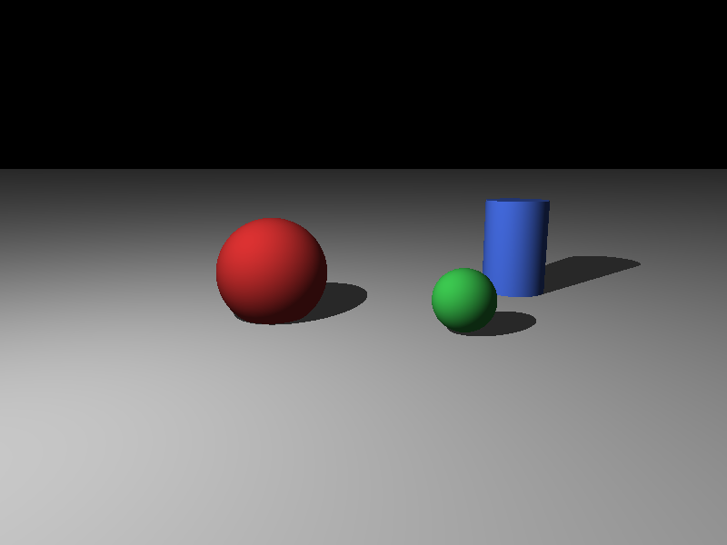
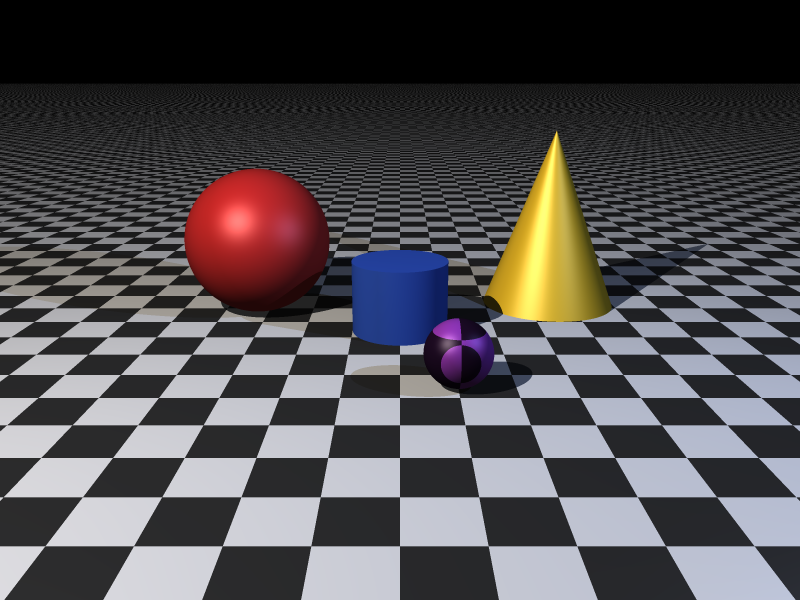
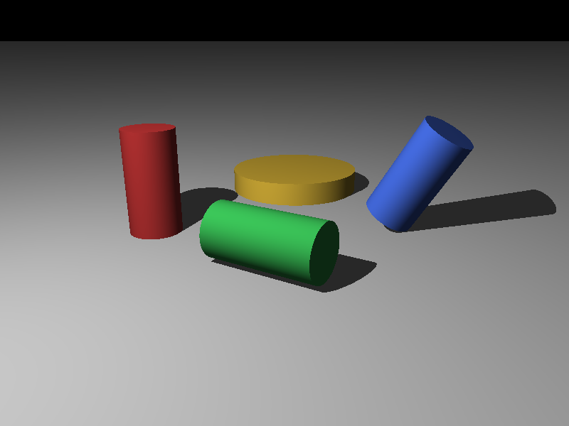
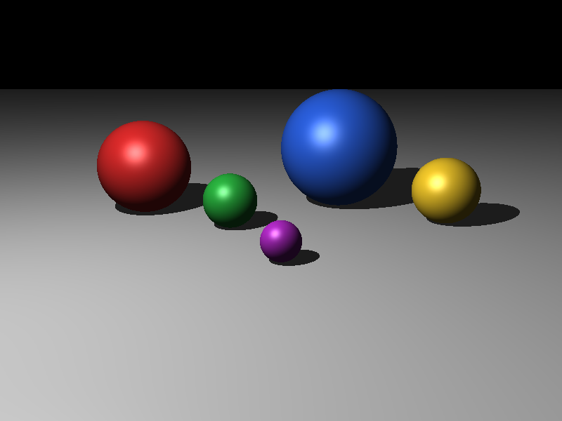
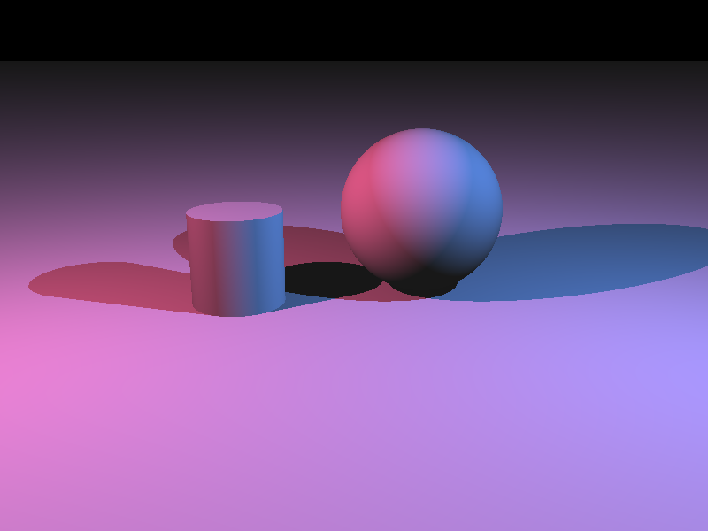
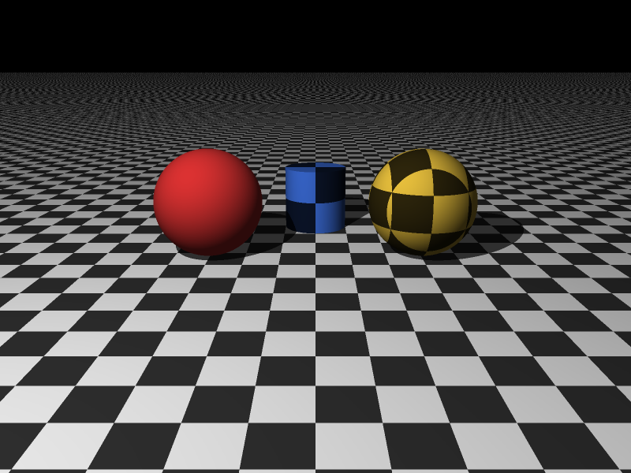
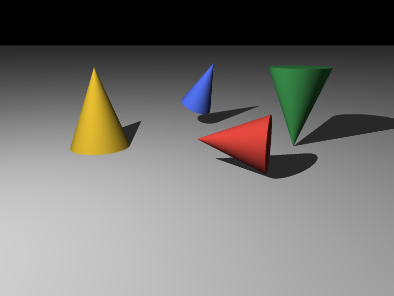
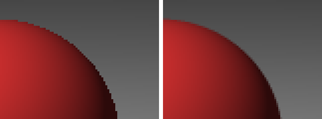

# miniRT — трассировщик лучей

[](https://github.com/__GITHUB_USER__/minirt-python/actions/workflows/ci.yml)



*scenes/three.rt, 800×600: плоскость, две сферы и цилиндр, фоновый и диффузный свет, тени.*

## Описание

Программа строит изображение сцены, описанной в текстовом файле `.rt`, методом
трассировки лучей. Задание сделано по мотивам проекта
[miniRT школы 42](https://projects.intra.42.fr/projects/minirt). Там его пишут на C с
библиотекой MiniLibX, здесь — на Python + NumPy.

Как это работает. Из камеры через центр каждого пикселя пускается луч. Среди всех объектов
находится первое пересечение с ним. В точке попадания вычисляются нормаль и цвет: фоновый свет
плюс диффузный по закону Ламберта. Из точки к источнику пускается теневой луч, и если источник
заслонён, точка получает только фоновый свет.

Кадр 800×600 — это 480 000 лучей, поэтому весь расчёт идёт на массивах NumPy. Начала и
направления лучей хранятся массивами `(N, 3)`, функция пересечения обрабатывает их за один
вызов, а ветвления заменены масками и `np.where`. Цикл на Python остаётся только по объектам
сцены и источникам света.

```
файл .rt → parse_scene_file → Scene → ray_directions (H, W, 3) → closest_hit → нормали
         → shade (фон + Ламберт + тени) → to_rgb8 → PNG / окно
```

Помимо обязательной части, выполнены все шесть дополнительных заданий: блики Фонга,
шахматная раскраска, цветные источники, конус, сглаживание и многопроцессность.



*scenes/showcase.rt с `--specular --samples 3`: шахматный пол и шар, конус, два источника
разного цвета, блики, сглаживание.*

## Установка и запуск

Нужен Python 3.11 или новее. Из зависимостей — NumPy и pygame (окно).

```bash
python -m venv .venv
source .venv/bin/activate          # Windows: .venv\Scripts\activate
pip install -r requirements.txt    # для разработки: pip install -r requirements-dev.txt
```

```bash
python main.py scenes/three.rt                                   # окно 800×600, выход — Esc
python main.py scenes/three.rt --width 1280 --height 720         # другой размер
python main.py scenes/three.rt --out three.png                   # окно + сохранение в PNG
python main.py scenes/cylinders.rt --no-window --out cyl.png     # без окна
python main.py scenes/showcase.rt --specular --samples 3 --workers 0   # все доп. задания
```

| Параметр | Назначение |
|---|---|
| `--width`, `--height` | размер изображения, по умолчанию 800×600 (допустимо 1..8192) |
| `--out файл.png` | сохранить результат в PNG |
| `--no-window` | не открывать окно |
| `--specular` | доп.: блики Фонга |
| `--samples N` | доп.: сглаживание, N² лучей на пиксель по регулярной сетке (1..16) |
| `--workers N` | доп.: число процессов; `0` — по числу ядер (по умолчанию 1) |

Время построения кадра печатается в stderr: `scenes/three.rt: 800x600, построено за 0.27 с`.

Коды возврата:
- `0` — успех;
- `1` — ошибка сцены или ввода-вывода: в stderr строка `Error`, затем причина, например
  `строка 7: у элемента sp ожидается 3 полей, получено 2`;
- `2` — неверные аргументы: печатается справка.

## Формат сцены

Каждая непустая строка описывает один элемент: идентификатор и поля через пробелы. Векторы и
цвета записываются тремя числами через запятую без пробелов. Текст после `#` — комментарий.
Оси: x — вправо, y — вверх, z — вглубь сцены.

| Элемент | Поля | Ограничения |
|---|---|---|
| `A` — фоновый свет | яркость, цвет | ровно один; яркость 0..1; цвет — три целых 0..255 |
| `C` — камера | позиция, направление взгляда, угол обзора | ровно одна; компоненты направления в [−1, 1], вектор не нулевой (нормируется); 0 < fov < 180 |
| `L` — источник света | позиция, яркость, цвет | хотя бы один; яркость 0..1 |
| `sp` — сфера | центр, диаметр, цвет | диаметр > 0 |
| `pl` — плоскость | точка, нормаль, цвет | нормаль — как направление камеры |
| `cy` — цилиндр | центр оси, ось, диаметр, высота, цвет | диаметр и высота > 0; крышки на ±высота/2 от центра |
| `co` — конус (доп.) | вершина, ось к основанию, диаметр основания, высота, цвет | диаметр и высота > 0 |
| флаг `checker` (доп.) | последнее поле объекта `sp`, `pl`, `cy`, `co` | шахматная раскраска |

Пример — `scenes/three.rt`:

```
# классическая сцена: плоскость, сфера, цилиндр
A 0.2 255,255,255
C 0,3,-10 0,-0.2,1 70
L -6,8,-4 0.8 255,255,255
pl 0,-1,0 0,1,0 200,200,200
sp -2.5,0.2,4 3 220,50,50
sp 2.5,-0.2,2.5 1.6 60,200,80
cy 5,0,7 0,1,0 2 4 70,110,230
```

Любое нарушение формата — `SceneFormatError` (наследник `RtError`) с причиной и номером
строки. По одной сцене на каждый вид ошибки лежит в `scenes/bad/`.

| Сцена | Что показывает |
|---|---|
| `scenes/three.rt` | эталонная сцена задания |
| `scenes/sphere.rt` | одна сфера: проверка камеры и освещения |
| `scenes/cylinders.rt` | четыре цилиндра: вертикальный, лежащий, наклонный, низкий широкий |
| `scenes/phong.rt` | доп.: пять шаров для бликов, запуск с `--specular` |
| `scenes/lights.rt` | доп.: два цветных источника, цветные тени |
| `scenes/checker.rt` | доп.: шахматная раскраска пола, шара и цилиндра |
| `scenes/cone.rt` | доп.: конусы — стоящий, лежащий, перевёрнутый, наклонный |
| `scenes/showcase.rt` | все дополнительные задания вместе |
| `scenes/bad/*.rt` | 22 сцены с ошибками формата (и `not_a_scene.txt` с неверным расширением) |



### Дополнительные задания

| Задание | Как устроено | Снимок |
|---|---|---|
| Блики Фонга (`--specular`) | к каждому источнику добавляется k · max(0, n·h)^p · яркость_L · c_L, h = normalize(l + v), k = 0,5, p = 32; в тени бликов нет |  |
| Цветные источники | сумма вкладов всех `L`; цвет источника умножается на цвет объекта покомпонентно; тень — для каждого источника своя |  |
| Шахматная раскраска | клетка — чётность ⌊x/s⌋ + ⌊y/s⌋ + ⌊z/s⌋, s = 1; нечётные клетки — цвет объекта × 0,2; точка сдвигается внутрь объекта на 10⁻⁴, чтобы грань на границе клеток не мерцала |  |
| Конус | бок — квадратное уравнение \|w\|² = (1 + k²)·m², k = R/h, с проверкой 0 ≤ m ≤ h (зеркальная половина отбрасывается); луч вдоль образующей — линейное уравнение; основание — диск |  |
| Сглаживание (`--samples N`) | N² лучей на пиксель со смещениями (k + 0,5)/N, цвет — среднее до перевода в байты; слева 1 луч, справа 9 |  |
| Многопроцессность (`--workers N`) | кадр делится на 4·N полос, полосы считаются в `ProcessPoolExecutor`; результат побайтно совпадает с однопроцессным | замеры — в разделе «Производительность» |

## Структура проекта

| Модуль | Назначение |
|---|---|
| `main.py` | точка входа: `sys.exit(main())` |
| `minirt/cli.py` | аргументы командной строки, коды возврата, сообщения `Error`, замер времени |
| `minirt/errors.py` | `RtError` и наследники: `SceneFormatError`, `WindowError` |
| `minirt/scene.py` | модель сцены: неизменяемые dataclass `Ambient`, `Camera`, `Light`, `Sphere`, `Plane`, `Cylinder`, `Cone`, `Scene` |
| `minirt/parser.py` | `parse_scene_text`, `parse_scene_file`: разбор и проверка `.rt`, флаг `checker` |
| `minirt/vec.py` | векторная математика над массивами `(..., 3)`: `dot`, `norm`, `normalize`, `cross` |
| `minirt/camera.py` | базис камеры `camera_basis` и лучи через пиксели `ray_directions` |
| `minirt/intersect.py` | пересечения со сферой, плоскостью, цилиндром и конусом, нормали, `closest_hit`, `occluded`, отсечение по описанной сфере |
| `minirt/lighting.py` | фоновый свет, Ламберт, теневые лучи со сдвигом `SHADOW_BIAS`, блики Фонга |
| `minirt/pattern.py` | шахматная раскраска |
| `minirt/render.py` | `render`: кадр полосами строк, сглаживание, процессы; `trace` — цвет для массива лучей |
| `minirt/image_io.py` | запись PNG на zlib + struct, без сторонних библиотек |
| `minirt/window.py` | окно pygame — единственный модуль, который импортирует pygame |
| `tools/naive.py` | тот же алгоритм циклом по пикселям на чистом Python — эталон для замеров |
| `tools/bench.py` | замеры для таблиц производительности |
| `tools/gallery.py` | пересборка снимков в `docs/` |
| `tests/` | тесты pytest |

## Тесты

```bash
pytest -q
mypy --strict minirt main.py
ruff check . && ruff format --check .
```

Эти три команды запускает CI (GitHub Actions) на Python 3.11, 3.12 и 3.13 при каждом push
в `main` и в каждом pull request. Всего 219 тестов.

Что проверяют тесты:
- **парсер:** полный разбор `three.rt`, нормировка направлений, радиус = диаметр / 2,
  комментарии и пустые строки, форматы чисел. Каждая сцена из `scenes/bad/` проверяется
  с точным текстом сообщения и номером строки;
- **векторная математика и камера:** ортонормированность базиса, центральный и крайние лучи
  (отклонение ровно fov/2), взгляд вертикально вниз;
- **пересечения** на ответах, посчитанных на бумаге. Сфера: мимо, снаружи, изнутри, позади,
  по касательной. Плоскость: обычный случай, позади камеры, параллельный луч. Цилиндр: бок,
  крышка, мимо выше крышки, луч вдоль оси, наклонная ось, нормали бока и крышки;
- **освещение:** cos = 1 даёт полную яркость, скользящий свет — ноль, источник за объектом —
  только фон, тень на плоскости от сферы, отсутствие теневого акне;
- **кадр целиком:** размер и тип, чёрный фон вверху, освещённый пол внизу, нижняя сторона
  плоскости;
- **сверка с эталоном:** векторный рендер совпадает с попиксельным `tools/naive.py`;
- **точка входа:** коды 0/1/2, `Error` и причина в stderr, запись PNG, вызов окна;
- **дополнительные задания:**
  - блик в зеркальном направлении, отсутствие блика в тени;
  - сумма цветных источников и тени для каждого из них;
  - чётность клеток, отсутствие мерцания на границе клеток;
  - конус: бок, основание, зеркальная половина, луч вдоль образующей, нормали;
  - сглаживание совпадает с суперсэмплингом и усреднением;
  - многопроцессный кадр совпадает с однопроцессным.

## Производительность

Замер: `perf_counter` вокруг `render`. Значения — лучшее и медиана из нескольких запусков
по `python tools/bench.py --naive --bonus --parallel`.

Машина: Intel Core i5-14400F (Linux-VM с 2 логическими ядрами), Python 3.13.16, NumPy 2.5.4.

| Сцена | Разрешение | Параметры | Время (лучшее / медиана), с | Примечание |
|---|---|---|---|---|
| scenes/three.rt | 800×600 | — | **0.27 / 0.27** | норматив — 3 с |
| scenes/three.rt | 400×300 | — | 0.07 / 0.07 | |
| scenes/three.rt | 1600×1200 | — | 0.84 / 0.86 | |
| scenes/cylinders.rt | 800×600 | — | 0.32 / 0.33 | 4 цилиндра |
| scenes/three.rt | 800×600 | чистый Python (`tools/naive.py`) | 2.78 | 5.8 мкс на пиксель |
| scenes/phong.rt | 800×600 | `--specular` | 0.32 / 0.35 | |
| scenes/lights.rt | 800×600 | — | 0.35 / 0.35 | 2 источника — 2 теневых луча |
| scenes/checker.rt | 800×600 | — | 0.28 / 0.29 | |
| scenes/cone.rt | 800×600 | — | 0.28 / 0.29 | 4 конуса |
| scenes/three.rt | 800×600 | `--samples 2` | 0.65 / 0.65 | 4 луча на пиксель |
| scenes/three.rt | 800×600 | `--samples 3` | 1.60 / 1.61 | 9 лучей на пиксель |
| scenes/showcase.rt | 800×600 | `--specular --samples 2` | 1.41 / 1.44 | все доп. задания |

Норматив задания — 3 с на `three.rt` при 800×600; выполняется с десятикратным запасом.
Векторная версия быстрее попиксельной в 10 раз на том же алгоритме (Python 3.13 заметно
быстрее интерпретатора, на котором замерен эталон задания) и даёт то же изображение — это
проверяет `tests/test_naive.py`. Сглаживание стоит пропорционально числу лучей: ×4 для
`--samples 2`, ×9 для `--samples 3`.

**Многопроцессность** — `scenes/three.rt`, 1600×1200, `--samples 2` (7,7 млн лучей):

| `--workers` | Медиана, с | Ускорение |
|---|---|---|
| 1 | 2.66 | ×1.00 |
| 2 | 1.52 | ×1.75 |
| 4 | 1.56 | ×1.71 |

На двух ядрах ускорение ×1,75. Четыре процесса на двух ядрах уже ничего не дают. До ×2 не
хватает времени на запуск процессов и сборку полос. На маленьком кадре 800×600 без
сглаживания запуск процессов съедает больше, чем экономит, поэтому по умолчанию
`--workers 1`.

**Что дал профиль** `python -m cProfile -s cumtime main.py scenes/cylinders.rt --no-window`
(замеры этой таблицы — на облачной VM Intel Xeon @ 2.10 GHz, 2 ядра, Python 3.13.18):

1. **Отсечение по описанной сфере.** Больше половины времени уходило на `intersect_cylinder`:
   точная проверка боковой поверхности и двух крышек шла для всех 480 000 лучей, хотя
   цилиндр занимает малую часть кадра. Теперь дешёвая проверка `bounding_candidates`
   отбирает лучи, проходящие через описанную сферу цилиндра (или конуса), и точное
   пересечение считается только для них.
2. **Рендер полосами.** Весь кадр одним проходом создаёт десятки временных массивов
   `(N, 3)`. При 1600×1200 это сотни мегабайт, они не помещаются в кэш, и время скачет
   от запуска к запуску. Теперь кадр считается полосами строк по ~64 тыс. лучей
   (`BAND_PIXELS`), и время растёт линейно с числом пикселей.

| Изменение | Сцена, разрешение | До (лучшее / медиана), с | После, с |
|---|---|---|---|
| отсечение по описанной сфере | cylinders.rt, 800×600 | 0.84 / 0.92 | 0.37 / 0.41 |
| рендер полосами | three.rt, 1600×1200 | 1.41 / 2.76 | 1.02 / 1.05 |
